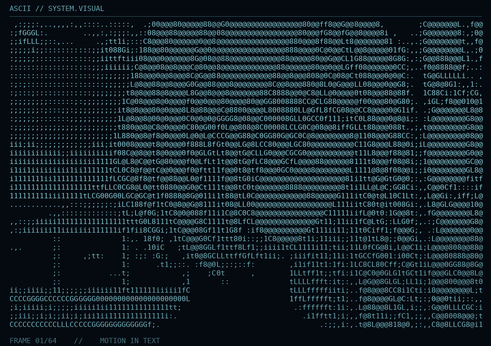

# Thanapat Manasom 👋
 

  

 

  

 

  

 

  
  
  
  
  
  
  
  
  
  
  
  
  
  

 

## 👨‍💻 About Me

I am a **Computer and AI Engineering undergraduate** passionate about building intelligent systems, developing reliable software, and bridging the gap between hardware and artificial intelligence.

My interests span **AI/ML Engineering, High-Performance Computing, Robotics, DevOps, Cybersecurity, Competitive Programming, and Capture The Flag (CTF)**.

With experience in competitive hackathons, I enjoy tackling complex engineering challenges, optimizing systems, and continuously improving my problem-solving and security research skills.

---

## 📊 GitHub Stats & Activity

  
  

---

## 🏆 Competitive Programming

  

    <i>Consistency, algorithmic thinking, and continuous improvement.</i>
  

  <h3>⚡ Competitive Programming Platforms</h3>

  
  
  
  
  

 

### 📈 LeetCode Statistics

  

 

### 📊 Codeforces Statistics

  

 

### 🎯 Competitive Programming Profiles

| Platform | Username | Profile |
|:---:|:---:|:---:|
| 🟠 LeetCode | `mntoyg` | [View Profile](https://leetcode.com/u/mntoyg/) |
| 🔵 Codeforces | `dxe064g` | [View Profile](https://codeforces.com/profile/dxe064g) |
| 🟤 CodeChef | `mntoyg` | [View Profile](https://www.codechef.com/users/mntoyg) |
| ⚫ AtCoder | `LightT` | [View Profile](https://atcoder.jp/users/LightT) |
| 🔷 Topcoder | `d04x` | [View Profile](https://profiles.topcoder.com/d04x) |

### 🧠 Algorithmic Skills

---

## 🛡️ Capture The Flag (CTF) & Cybersecurity

  

    <i>Think like an attacker. Build like a defender.</i>
  

  <h3>🚩 CTF & Cybersecurity Platforms</h3>

  

  

  

  

 

### 🌐 Cybersecurity Platform Profiles

| Platform | Username / ID | Profile |
|:---:|:---:|:---:|
| 🚩 picoCTF | `sklsjgjmts1` | [View Profile](https://learn.cylabacademy.org/users/sklsjgjmts1) |
| 🔴 TryHackMe | `LightTriad` | [View Profile](https://tryhackme.com/p/LightTriad) |
| 🟢 Hack The Box | `2470386` | [View Profile](https://app.hackthebox.com/users/2470386) |
| ⚫ Root-Me | `light-triad` | [View Profile](https://www.root-me.org/light-triad?lang=en) |

 

### 🔐 Cybersecurity & CTF Skills

 

### 🎯 CTF Learning Journey

- [ ] Web Exploitation
- [ ] Cryptography
- [ ] Reverse Engineering
- [ ] Binary Exploitation
- [ ] Digital Forensics
- [ ] OSINT & Security Research
- [ ] Active Directory & Network Security
- [ ] Malware Analysis & Threat Research

---

## 🔬 Current Focus & Research

- **AI & High-Performance Computing:** Exploring agentic AI, system design patterns, and NVIDIA NIM APIs for intelligent applications.
- **Hardware & Robotics:** Integrating NVIDIA Jetson modules into custom hardware and AI-powered robotics projects.
- **DevOps & Automation:** Designing and maintaining reliable CI/CD pipelines with GitHub Actions and containerized environments.
- **Cybersecurity & Cryptography:** Exploring AI-assisted malware analysis, OSINT, cryptographic techniques, and security research.
- **Competitive Programming:** Strengthening algorithmic problem-solving, data structures, and computational thinking.
- **CTF & Offensive Security:** Developing practical security skills through hands-on challenges, vulnerability analysis, and ethical hacking labs.

---

## 💻 Technical Arsenal

  <h3>⚙️ Core Languages & Systems</h3>
  

    

  <h3>🎨 Frontend Engineering</h3>
  

    

  <h3>🧩 Backend Engineering & Databases</h3>
  

    

  <h3>🧠 AI, Machine Learning & Deep Learning</h3>
  

   

  
  
  
  
  

    

  <h3>☁️ AI Infrastructure, MLOps & DevOps</h3>
  

   

  
  
  
  

    

  <h3 align="center">
  🧬 Deep Learning Architectures & Neural Networks
</h3>

  <!-- Foundation Architectures -->
  
  
  
  
  

   

  <!-- Generative AI -->
  
  
  
  

   

  <!-- Advanced Architectures -->
  
  
  
  

   

  <!-- Multimodal & Representation Learning -->
  
  
  
  

  <h3>🛡️ Cybersecurity & Security Research</h3>

  

  

   

  
  
  
  

    

  <h3>🤖 Embedded Systems, IoT & Robotics</h3>

  

   

  
  

<h3 align="center">🤖 AI Coding Assistants & Developer Tools</h3>

  

  

  

  

  

  

 

<h3 align="center">📊 Data Analytics & Visualization</h3>

  

    

  
  
  

   

  
  
  
  

   

  
  
  

---

---

## ⏱️ Coding Time & Language Statistics

  

    <i>Tracking my coding journey, one hour at a time.</i>
  

  

 

### 📊 Programming Language Activity

<!--START_SECTION:waka-->
<!--END_SECTION:waka-->

 

### 📋 Lifetime Programming Hours

> Manually maintained. Update using verified historical records.

| Language | Total Hours |
|:---|---:|
| 🐍 Python | TBD |
| ⚙️ C++ | TBD |
| 🐹 Go | TBD |
| 🦀 Rust | TBD |
| 🟨 JavaScript | TBD |
| 🔷 TypeScript | TBD |
| 🖥️ Bash | TBD |
| **Total** | **TBD** |

---

## 🐍 GitHub Contributions

  

---

## 📈 Development Metrics

  

---

  

  

    <i>Thanks for dropping by! Keep coding, keep building. ☕</i>
  

  <a href="#thanapat-manasom-">
    <b>⇧ Back to Top</b>
  </a>

